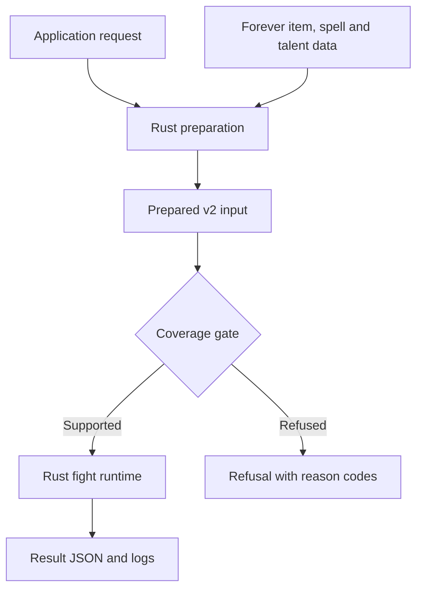
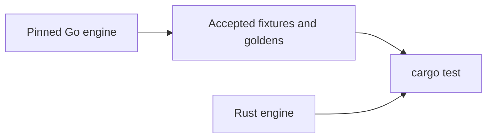

# Architecture

## Production path

[`tools/route.py`](routing.md) runs this path for the MythicSim worker in one process. Rust
never calls Go during preparation or a fight on this path. See the [prepared v2
contract](prepared-v2.md) and [Rust preparation](rust-preparation.md).

## Code layout

Shared scheduling, RNG and combat primitives live in `core` and `mechanics`, the fight
runtime in `core/fight`, and class spells, talents and specs under `classes`. The engine owns
orchestration, and shared code does not import classes. Contracts and report types stay at
the boundary. See the [contributor code map](contributor-guide.md) for exact paths, dependency
rules and new-class examples.

## Go as a test reference

Checked-in fixtures and goldens let Rust tests run without Go. The Go tools under `tools/`
capture new goldens and compare live at the [reference pin](../UPSTREAM.md), and
`tools/matched-go` is a benchmark control for the narrow prepared kernel, not the full Go
engine. Mechanics Go never had are checked against the client instead; see
[Rust-only mechanics](rust-only-mechanics.md).
